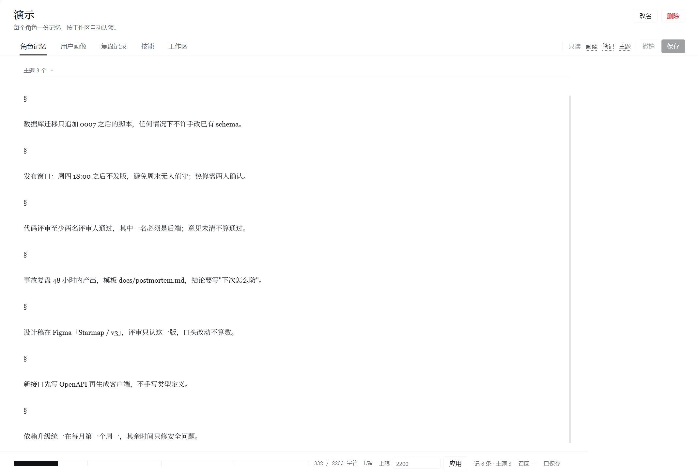
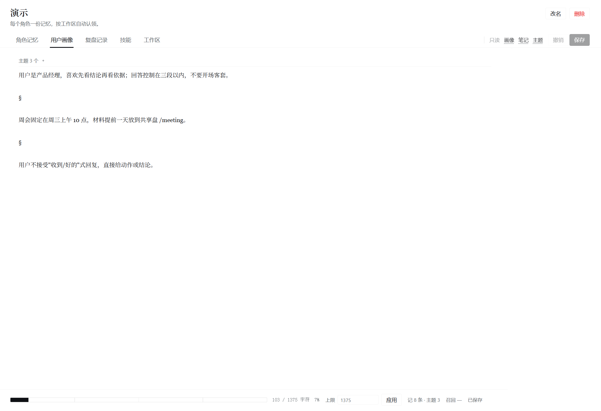

# dsh-persona

[](https://github.com/TBAOT/dsh-persona/actions/workflows/verify.yml)

**Memory for DeepSeek Harness, one per persona.** It writes itself, it stays small, and you can
always see and edit what it holds.



## What it is

After installing, the left sidebar gains a “角色” page. Every persona gets its own profile,
its own notes and its own topic library. They enter the prompt when a session starts, and a
review at the end of each turn writes new facts back — so you never have to say “remember this”.

What it does for you:

- **It remembers you**: how you like to be spoken to, what to avoid, how you work.
- **It separates projects**: one memory per persona, so project A's conventions stay out of project B.
- **It tidies itself**: one fact per entry; when a tier fills, new facts move into topics.
- **You stay in control**: edit or delete any entry in the panel; every write is logged.



## Quick start

```sh
# 1. install
dsh plugin --profile <profile> add github:TBAOT/dsh-persona

# 2. add dsh-persona to the profile's dsh.profile.bundles, then restart the Harness
```

3. Open “角色” in the sidebar → create a persona → bind a workspace to it.
4. Just chat. Memory starts filling in after the first turn.

Requires DSH `>=0.2.2-rc.1`. Nothing else is required.

## The panel

| Tab | What it is for |
|---|---|
| Memory | Edit this persona's notes; the footer shows usage, the limit and the last recall readout |
| Profile | Edit “who you are, what you want”, stored separately from the notes |
| Review log | Every automatic write or rejection: what changed, which model, why it was refused |
| Skills | Skills owned by this persona only |
| Workspaces | Bind directories; sessions under them belong to this persona |

The `只读 画像 笔记 主题` row on the right is a guard: set a tier read-only and the agent can no
longer write it — you still can, from the panel.

## Commands

```sh
pnpm health    # did recall actually inject lately, and what did it cost
pnpm audit     # structure check: empty summaries, over-long or duplicate entries, policy drift
pnpm probe     # retrieval quality on 14 real questions (hit rate / injected chars / latency)
```

## Where the data lives

```
~/.dsh/personas/<persona>/
├─ memory/user.md       your profile (resident)
├─ memory/memory.md     the persona's notes (resident)
├─ memory/meta.json     per-entry state: hash chain, invalidation, timestamps
├─ memory/policy.json   read-only tiers and caps (written by the panel only, optional)
├─ topics/              topic library: detail on demand
└─ review/              metrics.jsonl / log.jsonl / backups
```

Workspace → persona mapping lives in `~/.dsh/personas/index.json`.

## FAQ

**Can it remember something wrong?**
Edit it in the panel. If you want a guarantee, set that tier read-only: the agent can no longer
write it, and only you can change it.

**Will it bloat the prompt?**
Resident tiers have hard caps; when one fills, new facts spill into topics, and single entries
have their own length limit.

**What happens when DSH is upgraded?**
The plugin probes the host API at startup and reports it in `pnpm health`; if its own setup fails
it disables itself instead of blocking Harness startup. A daily workflow also watches DSH release
notes for changes that touch the interfaces this plugin uses.

## Going deeper

- [docs/guide.md](docs/guide.md) — tiers, write paths, configuration, limits (the “why”)
- [CHANGELOG.md](CHANGELOG.md) — what changed in each release
- [Releases](https://github.com/TBAOT/dsh-persona/releases) — package with docs and screenshots

## Privacy

Memory stays on this machine under `~/.dsh/personas/`. One exception: the per-turn review sends a
conversation summary to the model configured in Harness. Set `config.enabled: false` to disable it;
manual editing still works.

## Security boundary

The panel's HTTP API listens on loopback only and requires an `x-dsh-persona: 1` header — that is
misclick protection, not authentication. Do not expose the port.

## Uninstall

```sh
dsh plugin --profile <profile> remove dsh-persona
```

Memory directories are kept; delete `~/.dsh/personas/<persona>` yourself if you want them gone.

## License

MIT
