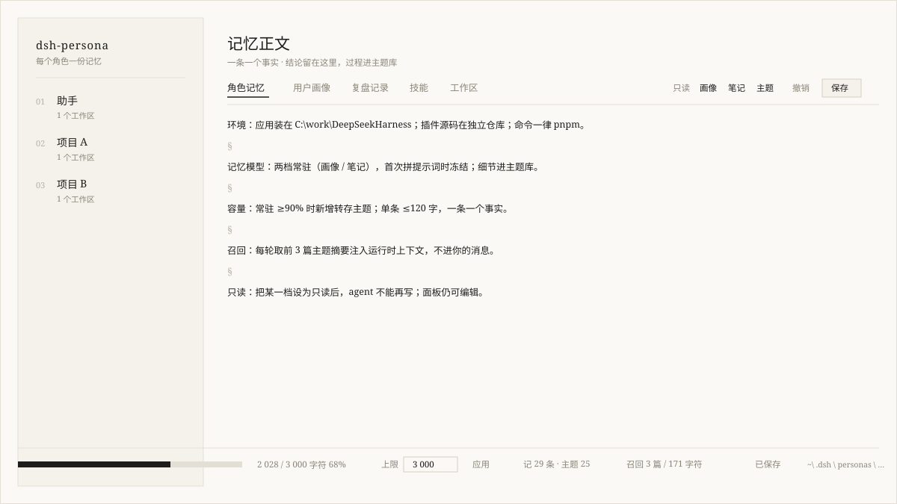

# dsh-persona

[](https://github.com/TBAOT/dsh-persona/actions/workflows/verify.yml)

**DeepSeek Harness remembers you — and only what is worth keeping.** One independent
memory per persona: two resident tiers (your profile + the persona's own notes) plus a
topic library read on demand. A per-turn review writes it for you, so you never have to
say "remember this".



```sh
dsh plugin --profile <profile> add github:TBAOT/dsh-persona
# add dsh-persona to the profile's dsh.profile.bundles, then restart the Harness
```

Requires DSH `>=0.2.2-rc.1`. No other configuration; the panel lives under “角色” in the
left sidebar.

- **It remembers**: profile and notes are injected at session start; entries can be added,
  patched and removed, and history is kept instead of hard-deleted.
- **It does not bloat**: one fact per entry (≤120 characters); when a tier fills, new
  facts spill into topics, and a background pass rewrites the tier after the review.
- **It is measurable**: `pnpm health` says whether recall actually injected, `pnpm audit`
  checks memory structure, `pnpm probe` scores retrieval against real questions.

> The name `dsh-persona` on npm belongs to someone else (a placeholder `0.0.1`).
> This repository is not published to npm — install it from git.

## Install

```sh
dsh plugin --profile <profile> add github:TBAOT/dsh-persona
```

Then add `dsh-persona` to the profile's bundle list and restart the Harness.

## What it gives you

- **Two memory tiers per persona** — `user` (who you are, how you want to be
  answered) and `memory` (the persona's own notes). Each has a hard character
  budget; an over-budget write is refused with the exact deficit, so the agent
  consolidates instead of silently losing entries.
- **Frozen prompt snapshot** — memory is read once when a session starts and
  never rewritten mid-session, which keeps the provider's prefix cache valid.
  Writes land on disk immediately and appear in the next session.
- **Automatic per-turn review** — after a turn settles, one model call reads a
  digest plus the current memory and returns structured edits. Nothing is
  written if the model finds nothing worth keeping, and every run is recorded.
- **Persona isolation by workspace** — a persona owns one or more workspace
  directories; sessions opened there use that persona's memory. One persona,
  many projects, one shared memory.
- **Private skills** — skills dropped into `personas/<id>/skills/` are indexed
  only for that persona's prompt. Shared skills keep living in the global roots.
- **Audit ledger** — every review run is listed with its status, duration,
  model, and the exact entries it added, changed or removed.

## Where the data lives

```
<DSH_HOME>/personas/
  index.json                 personas, workspace bindings, per-tier limits
  <persona>/memory/user.md   user profile      (default 1375 chars)
  <persona>/memory/memory.md persona notes      (default 2200 chars)
  <persona>/skills/          private skills
  <persona>/review/log.jsonl one line per review run
```

Everything is plain Markdown/JSONL: readable, diffable, and safe to back up.

## Panel

A sidebar entry named "角色" opens the panel:

- persona index with slot numbers, create / rename / delete
- two memory editors with a character ruler (turns red past 90%)
- review ledger with filters and expandable entries
- workspace binding per persona
- per-persona character limits (200–20000)

## Configuration

```yaml
- id: persona-memory
  name: dsh-persona
  config:
    personaId: default     # fallback persona when no workspace is bound
- id: persona-review
  name: dsh-persona/review
  config:
    enabled: true
    everyTurns: 1
    maxTokens: 1200
    dryRun: false          # true = record what it would write, write nothing
    provider: wb-proxy     # optional; defaults to the platform default model
    model: deepseek-v4.1-flash
```

## Retrieval and evaluation

- Scoring: a topic's `slug + summary + keywords` forms the head (70% of the score),
  the body contributes 30%; CJK is tokenised as character bigrams, latin as words,
  and every token is weighted by an IDF computed over the topic library so words
  that appear everywhere ("memory", "dsh") stop deciding the ranking.
- Topic front matter may carry one line of retrieval aliases:
  `keywords: permission backup,can I delete it`. Aliases widen what a topic can
  match, are scored as part of the head, and never cost a character of the index
  line in the prompt.
- Evaluation: `pnpm probe --persona=slot-1 --split=tune|verify` reports three
  numbers together — hit rate, average injected characters, average latency —
  broken down by single-hop / multi-hop / temporal / negative. Questions live in
  `test/probe/questions.json` and are taken verbatim from real sessions;
  `holdout` questions are reported separately from the tuning half, and a
  false-positive on a negative question fails the run.
- Baseline on 2026-11-15 (slot-1, 14 questions): tune 89% (8/9), verify 100%
  (5/5), 177 characters injected on average, ~4 ms.
- Known sensitivity: whether the IDF document frequency counts aliases flips one
  borderline holdout question (13/14 vs 12/14), so aliases are deliberately left
  out of the frequency count.

## Health check

`pnpm health` reads each persona's recent `review/metrics.jsonl` and answers whether
recall is actually running right now:

```
[slot-1] last 5 turns: injected 3 (injected×3 no-match×2)
   tokens in/out: 4976/1344
   newest: turn 9 @ 2026-11-15T10:03:39+08:00 → ok
```

Verdicts: `ok` / `broken` (shape or error failure) / `silent` (should have injected,
never did) / `unverified` (every row says `unknown`, so it cannot be attributed to a
turn) / `stale` (no recent activity). Only `broken` and `silent` exit non-zero.

`pnpm audit` looks at the memory itself: an empty topic summary, a topic over its cap,
near-duplicate topics, duplicate facts inside a tier or across user/memory, and meta
that no longer matches the files are errors; missing retrieval aliases, very long
entries and a nearly full tier are advisories, because judging what a fact is worth
is a human job.

## Confirming an upgrade took effect

Plugin code only enters memory after a reload or restart (especially when installed
via `link:`), so verify in three steps:

1. `pnpm health` — an `ok` verdict means recall did inject within the recent window;
2. Send any message, then read the last line of `<DSH_HOME>/personas/<id>/review/metrics.jsonl`:
   - `recall.outcome` should be `injected` / `no-match` / `trivial`, **never `unknown`**;
   - `recall.chars > 0` means the topics really went into the prompt this turn;
   - non-zero `tokens.in/out` means usage was captured (`usageMissing: true` means the
     stream carried no usage chunk at all).
3. A `silent` or `broken` verdict: read `recall.error` on that same line before
   suspecting the injection path in `lib/recall.js`.

## Privacy

- Memory is local plain text; nothing is uploaded by the plugin itself.
- The only text leaving the machine is what the model provider receives with a
  normal request, including the injected memory block.
- The review sends a conversation digest to the model you configured.

## API boundary

The panel API only serves the local machine: it requires the fixed
`x-dsh-persona: 1` header and refuses a non-loopback `Host`, a cross-site
`Origin`, and `OPTIONS` preflights. This is **not authentication** — any local
process can send that header — so do not expose this machine's DSH web port to
an untrusted network.

## Uninstall

Remove the bundle from the profile. Files under `<DSH_HOME>/personas/` are kept
so you can migrate or delete them yourself.

## License

MIT
