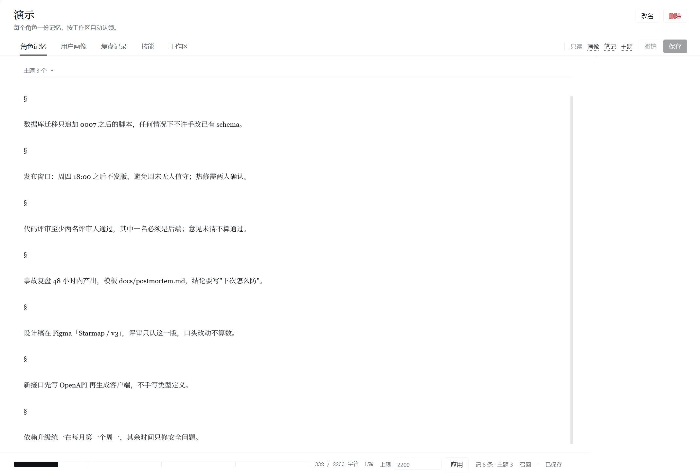
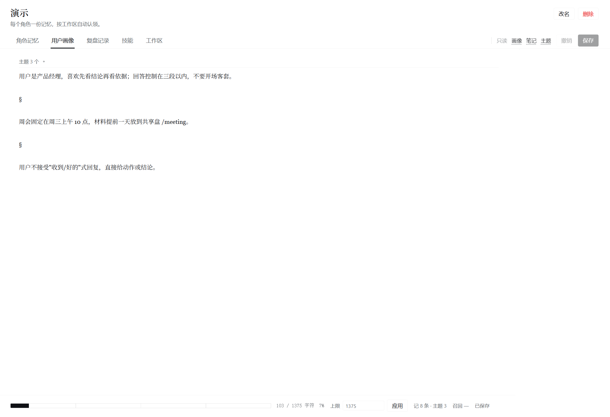

# dsh-persona-kit

[](https://github.com/TBAOT/dsh-persona-kit/actions/workflows/verify.yml)

给 DeepSeek Harness 的**角色记忆**：每个角色一份，自动写，不乱长，你随时看得见也改得动。



## 它是什么

装上之后，左侧栏多一个「角色」。每个角色有自己的用户画像、自己的笔记、自己的主题库；
会话开始时它们进入提示词，回合结束后自动复盘把新事实写回去——你不用再提醒它"记住这个"。

它替你做四件事：

- **记住你**：称呼、习惯、忌讳、协作方式，一次说清，之后每轮都在。
- **分清项目**：一个角色一份记忆，项目 A 的约定不会跑到项目 B 里去。
- **自己整理**：一条一个事实，写满自动转到主题库，常驻层不会越用越长。
- **让你审**：所有条目在面板里可改可删；写成什么样、什么时候写的，复盘记录里都有。



## 快速开始

```sh
# 1. 安装
dsh plugin --profile <profile> add github:TBAOT/dsh-persona-kit

# 2. 把 dsh-persona-kit 加进 profile 的 dsh.profile.bundles，然后重启 Harness
```

3. 打开左侧栏「角色」→ 新建角色 → 把工作区绑给它。
4. 正常聊天。下一次回合结束，记忆就开始长起来了。

需要 DSH `>=0.2.2-rc.1`。除此之外没有必填配置。

## 面板

| 页签 | 用来做什么 |
|---|---|
| 角色记忆 | 编辑这一角色的笔记；页脚显示用量/上限与最近一次的召回读数 |
| 用户画像 | 编辑"你是谁、你要什么"；和上面的笔记分开存 |
| 复盘记录 | 每次自动写入/拒绝的明细：改了什么、用了哪个模型、为什么没写 |
| 技能 | 这个角色独有的技能（SKILL.md），别的角色看不到 |
| 工作区 | 把目录绑给角色；该目录及子目录下的会话自动归它 |

页签行右侧的 `只读 画像 笔记 主题` 是护栏：点一下设为只读，agent 就写不进那一档，你仍然可以在面板里改。

## 常用命令

```sh
pnpm health    # 最近几轮召回是否真的注入了、token 花了多少
pnpm audit     # 记忆结构体检：空摘要、超长、近似重复、跨档重复、策略一致性
pnpm probe     # 用 14 道真实问题量检索质量（命中率 / 注入字数 / 耗时）
pnpm doctor    # 升级 DSH 前跑一次：profile 补丁与 link 依赖是否有问题
```

## 数据在哪

```
~/.dsh/personas/<角色>/
├─ memory/user.md       用户画像（常驻）
├─ memory/memory.md     角色笔记（常驻）
├─ memory/meta.json     条目元数据：hash 链、失效链、时间
├─ memory/policy.json   只读档与上限（仅面板写，可选）
├─ topics/              主题库：一篇一个细节，按需读取
└─ review/              metrics.jsonl / log.jsonl / 备份
```

工作区与角色的映射在 `~/.dsh/personas/index.json`。

## 常见问题

**它会不会记错、把画像写歪？**
可以在面板里直接改；不放心就把某一档设为只读，agent 从此写不进去，只有你能改。

**会不会把提示词撑爆？**
常驻层有上限，写满后新增内容转存主题库，常驻层只留结论。单条也有字数上限。

**升级 DSH 会不会坏？**
启动时会探测宿主接口并把结果写进 `pnpm health`；插件初始化失败时只停用它自己，不影响 Harness 启动。
仓库里还有一条每日巡检，DSH 发布新版本并触及本插件用到的接口时，会开 issue 提醒。

## 深入了解

- [docs/guide.md](docs/guide.md) —— 原理、配置项、容量规则、已知限制（想弄明白"为什么这样设计"看这份）
- [CHANGELOG.md](CHANGELOG.md) —— 每个版本改了什么
- [Releases](https://github.com/TBAOT/dsh-persona-kit/releases) —— 安装包（含文档与截图）

## 从 soul-md 迁移

```sh
node scripts/migrate-soul-md.mjs --soul-md <$DSH_HOME/soul-md> --persona <角色>
# 旧配置里还留着 soul-md 的，也可以：--patch <profile/cordis.patch.yml>
```

把 soul-md 的卡片与记忆搬进当前结构；超出上限的条目会跳过并在结果里列出来。

## 隐私

记忆全部存在本机 `~/.dsh/personas/`，不上传。例外只有一处：每轮复盘会把对话摘要发给模型，
用的是 Harness 里配置的模型（默认模型或插件行里指定的 provider/model）。不想让它发给模型就把
`config.enabled` 设为 `false`，记忆仍可手动编辑。

## 接口的安全边界

面板的 HTTP 接口只监听本机回环，并且要求 `x-dsh-persona-kit: 1` 请求头——这是**防误触**，不是身份认证。
不要把端口暴露到局域网。

## 卸载

```sh
dsh plugin --profile <profile> remove dsh-persona-kit
```

角色记忆目录不会被删除；不需要了再手动删 `~/.dsh/personas/<角色>`。

## 许可

MIT
